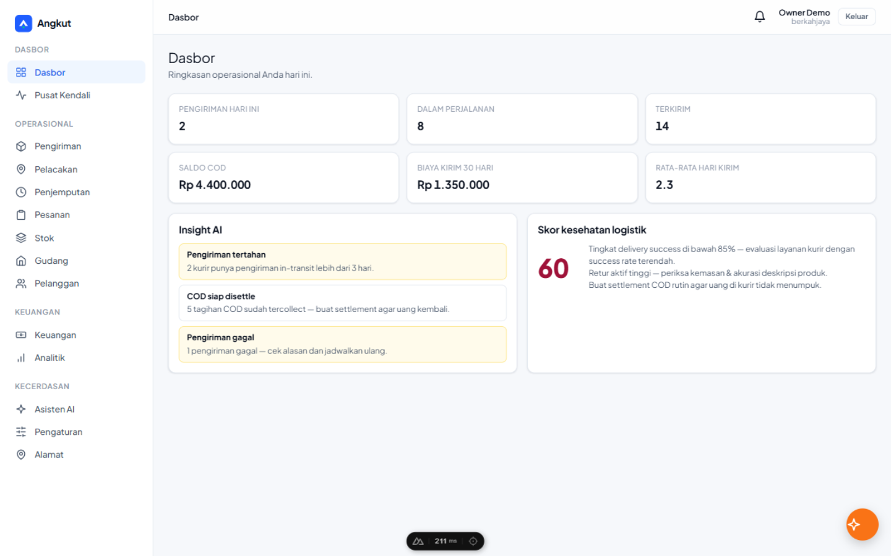
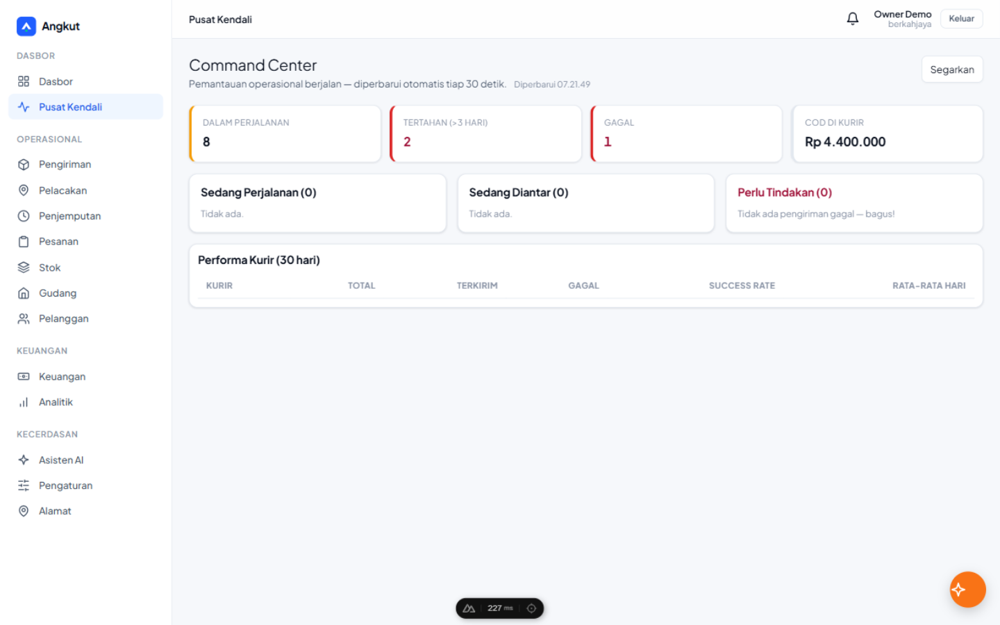
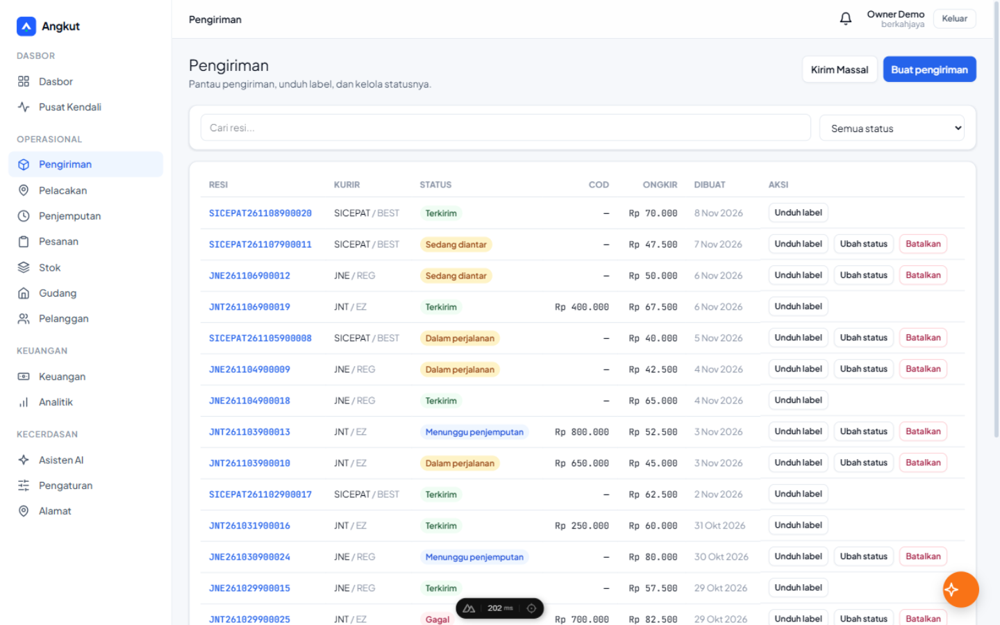
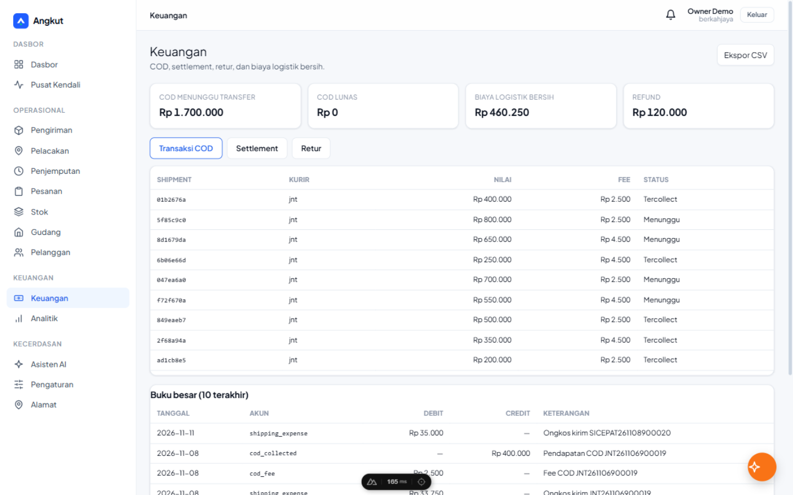
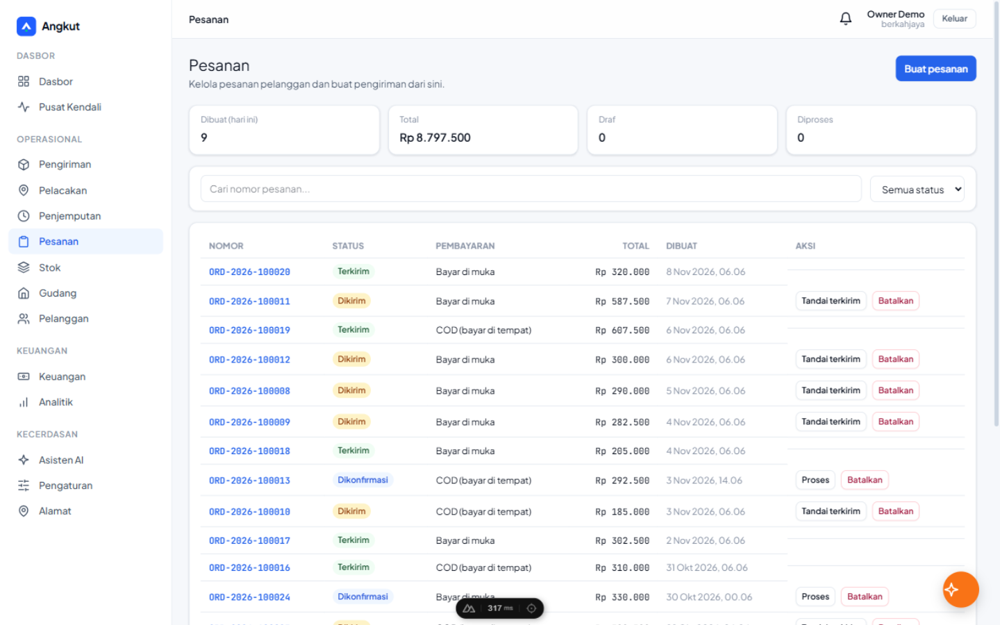
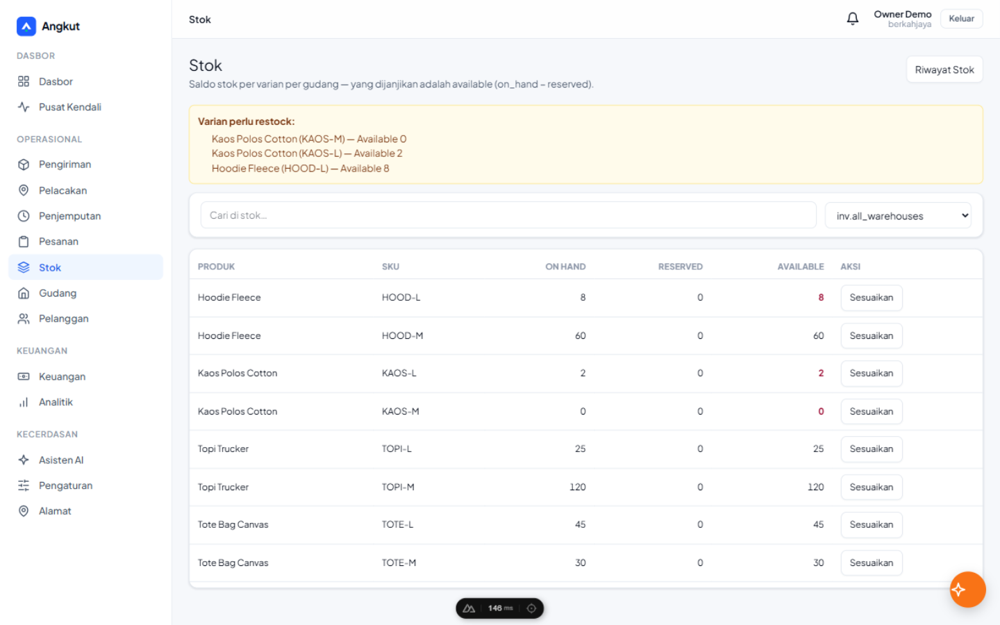
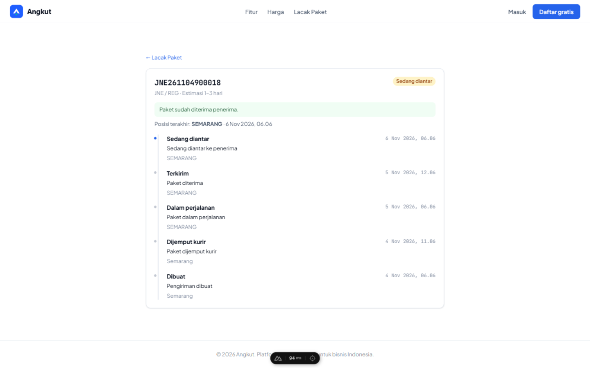
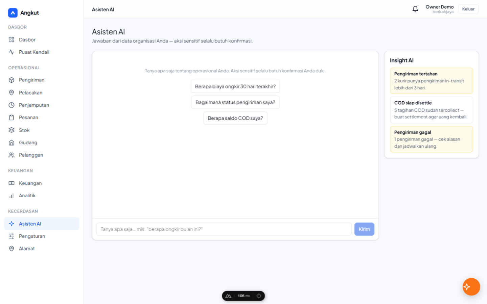
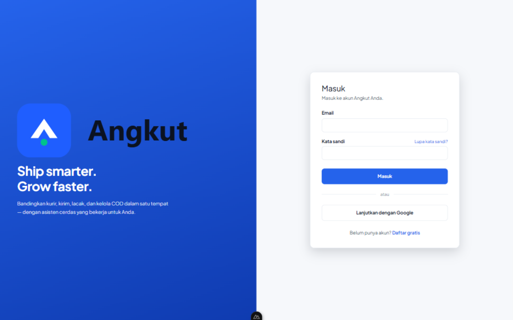

# Angkut — Intelligent Logistics OS

[](https://github.com/eka0789/angkut/actions/workflows/ci.yml)


**Platform agregasi logistik berbasis AI untuk bisnis Indonesia.** Satu dasbor untuk mengelola pengiriman multi-kurir, COD, gudang, dan keuangan — dengan asisten AI yang menjawab dari data organisasi Anda sendiri.

---

## Tampilan

| Dasbor | Pusat Kendali |
| --- | --- |
|  |  |
| **Pengiriman & Label** | **Keuangan (COD & Buku Besar)** |
|  |  |
| **Pesanan** | **Inventory Multi-Gudang** |
|  |  |
| **Lacak Publik** | **Asisten AI** |
|  |  |

*Halaman login (split-screen):* 

## Fitur

- **Pengiriman multi-kurir** — AWB otomatis, label PDF (A4 & thermal), state machine status yang ketat, idempotensi bawaan agar tidak ada pengiriman ganda.
- **Kirim massal CSV** — unggah ratusan baris, validasi per baris, laporan DITOLAK/OK, unduh semua label dalam satu ZIP.
- **Pelacakan realtime** — timeline kejadian per resi, halaman lacak publik untuk dibagikan ke pembeli, pembaruan tanpa refresh (SSE).
- **COD & keuangan** — tagihan COD per paket, settlement per kurir, buku besar append-only yang dilindungi trigger database, refund tercatat idempoten.
- **Inventory multi-gudang** — produk & varian SKU, saldo on-hand/reserved/available, movement append-only, transfer antar gudang atomik.
- **Pesanan & pelanggan** — order dari toko, segmentasi otomatis (VIP/regular/risiko), profil pelanggan dengan metrik.
- **Penjemputan** — jadwal pickup per kurir, tambah paket ke penjemputan yang terjadwal.
- **Asisten AI** — tanya biaya, status, COD; dijawab dari data organisasi Anda. Aksi sensitif selalu meminta konfirmasi.
- **Notifikasi & webhook** — notifikasi in-app + email, webhook kurir dengan verifikasi HMAC dan dedup.

## Tech Stack

| Lapisan | Teknologi |
| --- | --- |
| API & Worker | Go 1.24, chi, pgx v5, Clean Architecture |
| Frontend | Nuxt 4, Vue 3, TypeScript |
| Database | PostgreSQL 16 (migrasi golang-migrate, runner tertanam) |
| Infra lokal | Docker Compose — Postgres, Redis, RabbitMQ, MinIO, Mailpit |
| Kualitas | Go test `-race`, golangci-lint, ESLint, CI GitHub Actions |

## Mulai Cepat

```bash
cp .env.example .env          # default sudah cukup untuk dev
make up                       # postgres, redis, rabbitmq, minio, mailpit
make migrate-up               # terapkan migrasi
make seed                     # (opsional) data demo — lihat di bawah
make api                      # API  → http://localhost:8080
make worker                   # worker (terminal lain)
make web                      # Nuxt → http://localhost:3000
```

Cek kesehatan: `curl http://localhost:8080/healthz` → `{"status":"ok"}`.

> **Windows tanpa `make`:** `docker compose up -d` · `go run ./api/cmd/migrate up` ·
> `go run ./api/cmd/api` · `go run ./worker/cmd/worker` · `cd web && npm run dev`.

### Data demo

`seed_demo.sql` mengisi organisasi demo **berkahjaya** dengan 12 pelanggan,
26 pesanan/pengiriman lintas status + riwayat pelacakan, tagihan COD + ledger,
produk & stok dua gudang, retur, dan notifikasi:

```bash
psql "$DATABASE_URL" -f seed_demo.sql
```

### Akun demo

Semua akun memakai password `Demo1234!`:

| Email | Peran | Bisa apa |
| --- | --- | --- |
| `demo-owner@demo.angkut.id` | Owner | Akses penuh termasuk pengaturan |
| `demo-admin@demo.angkut.id` | Admin | Kelola operasional harian |
| `demo-finance@demo.angkut.id` | Finance | COD, settlement, keuangan |
| `demo-gudang@demo.angkut.id` | Warehouse | Gudang, stok, penjemputan |
| `demo-staff@demo.angkut.id` | Staff | Pengiriman & pelacakan (tanpa keuangan) |
| `demo-viewer@demo.angkut.id` | Viewer | Hanya lihat |

## Perintah

| Perintah | Fungsi |
| --- | --- |
| `make up` / `make down` | Start/stop stack dependensi (Docker) |
| `make migrate-up` / `make migrate-down` | Terapkan / batalkan migrasi |
| `make migrate-status` | Versi skema saat ini |
| `make migrate-create name=xxx` | Buat pasangan migrasi baru |
| `make api` / `make worker` / `make web` | Jalankan masing-masing service |
| `make test` | Unit test Go (`-race`) |
| `make lint` | golangci-lint + eslint |
| `make build` | Build `bin/angkut-api` & `bin/angkut-worker` |

Runner migrasi tertanam di binary: `go run ./api/cmd/migrate up|down [n]|status`.

## Struktur Proyek

```
apps/
├── api/            Go API server (interfaces/http → application → domain)
├── worker/         Go background workers (email, outbox, settlement)
├── web/            Nuxt 4 frontend (design system "Trust & Authority")
├── internal/       Application, domain, infrastructure (dipakai api & worker)
├── migrations/     SQL migrations 0001–0025
├── docs/           Tangkapan layar & panduan operasional
├── seed_demo.sql   Data demo organisasi "berkahjaya"
└── docker-compose.yml
```

Prinsip arsitektur: domain tidak boleh mengimpor `interfaces/` atau
`infrastructure/`; mutasi kritis idempoten (`Idempotency-Key`); integrasi
eksternal lewat outbox pattern; adapter vendor selalu punya `mock` sehingga
platform berjalan end-to-end tanpa kredensial eksternal.

## API

REST API dengan envelope JSON konsisten:

```json
{ "success": true, "data": {}, "error": null, "meta": { "total": 42 } }
```

Autentikasi JWT (refresh rotasi) atau API key. Semua mutasi kritis wajib
header `Idempotency-Key`. Ringkasan endpoint + contoh cURL tersedia di
halaman `/docs` pada aplikasi web.

## Operasional

Panduan rilis, unit systemd, konfigurasi nginx, dan skrip backup:
[`docs/operations/`](docs/operations/).

## Aturan Kontribusi

- Jalankan `git` dari direktori `apps/` (repo ini). Branch kerja: `dev`.
- Tidak ada credential di kode — semua via env (`apps/.env.example`).
- Setiap perubahan wajib lolos `make test` dan `make lint`.
